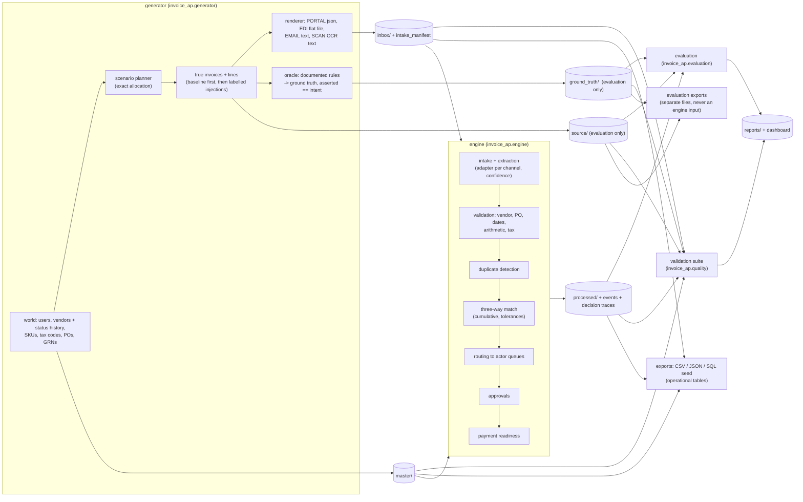
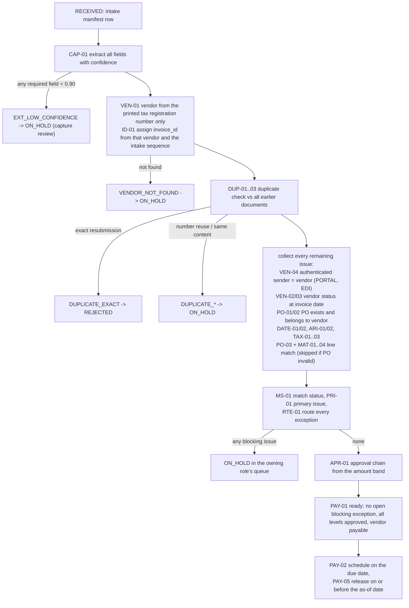

# Architecture

The module and file names below are the ones the code implements.

## 1. What the system does

The build has two halves that never share logic.

1. A **synthetic ERP world** (the generator). It creates vendors, POs, goods receipts and the invoices
   vendors send, renders each invoice as a document in its intake channel, and derives the expected
   outcome of every invoice with a rule-based **oracle**.
2. An **AP automation engine**. It sees only what a real AP department would see: ERP master data
   and an inbox of documents. It extracts fields, validates, detects duplicates, performs the
   three-way match, routes exceptions to the five actors, requests approvals and schedules payments.

The **evaluation** then compares the engine's output with the oracle's ground truth and with the
true source invoices. Because the engine works only from extracted documents, the metrics measure
real behaviour rather than restating what the generator already knew.



The diagram shows the order of the engine's concerns. The exact check order and its gates are in
section 4.

## 2. Components and module boundaries

| Package | Responsibility | Reads | Writes | May import |
|---|---|---|---|---|
| `invoice_ap.common` | Vocabulary (`enums`), ID formats, Decimal money, paths, policy loader, doc sync. No business logic. | `config/ap_policy.toml` | - | stdlib only |
| `invoice_ap.spec` | Machine-readable data dictionary; renders `docs/data_dictionary.md` and the JSON spec. | - | docs | `common` |
| `invoice_ap.generator` | Exact allocation, synthetic world, true invoices, injections, document rendering, oracle. | policy | `master/`, `inbox/`, `source/`, `ground_truth/` | `common`, `spec` |
| `invoice_ap.engine` | Intake, extraction, validation, duplicates, matching, routing, approvals, payments, events, explain. | policy, `master/`, `inbox/` **only** | `processed/` | `common`, `spec` **only** |
| `invoice_ap.evaluation` | Extraction accuracy, per-type precision/recall/F1, confusion matrix, duplicate pairs, approval and payment safety, KPIs. | everything | `reports/evaluation.*` | all |
| `invoice_ap.quality` | Defect-aware validation suite: PK, FK, enums, date order, arithmetic, lifecycles, duplicates. | everything | `reports/validation_summary.*` | all but `engine` internals |
| `invoice_ap.export` | CSV and JSON for every table; SQL seed with PK/FK/CHECK constraints. | everything | `exports/` | `common`, `spec` |
| `invoice_ap.report` | Source manifest, distribution summary, reproducibility report, offline HTML dashboard. | everything | `reports/` | all |
| `invoice_ap.cli` | `python -m invoice_ap <command>` | - | - | all |

## 3. Dataset layout of one build

```
data/<scale>/                 scale = starter | full
  master/        ERP data, engine-readable: actor_role, app_user, payment_terms, tax_code, sku, vendor,
                 vendor_status_history, purchase_order, purchase_order_line, goods_receipt,
                 goods_receipt_line, erp_event  (*.csv); snapshot_* columns are reporting only
  inbox/         engine-readable: intake_manifest.csv (no invoice_id; sender vendor only for
                 authenticated channels) + documents/<channel>/<doc_id>.<ext>
  source/        EVALUATION ONLY: invoice.csv, invoice_line.csv (the invoices as issued)
  ground_truth/  EVALUATION ONLY: ground_truth.csv + ground_truth.json, ground_truth_line.csv
  processed/     engine output: captured_invoice, captured_invoice_line, extraction_field,
                 invoice_decision, match_result, match_allocation (bridge), duplicate_pair,
                 ap_exception, approval, payment, ap_event, policy_version (*.csv) + decision_trace.jsonl
  exports/       json/<table>.json and sql/seed.sql for master, inbox and processed tables;
                 json/evaluation/ and sql/evaluation_seed.sql (separate files) for source and
                 ground truth, so labels never sit in the seed's input tables. The layer CSVs
                 above are the CSV export and are not copied again
  reports/       source_manifest.json, validation_summary.{json,md}, evaluation.{json,md},
                 distribution_summary.{json,md}, reproducibility.{json,md}, dashboard.html
```

The field-level definition of every table is in [data_dictionary.md](data_dictionary.md). Keys,
cardinalities and state machines are in [schema.md](schema.md).

## 4. Engine pipeline

Invoices are processed one at a time in intake order (`received_at`, then `doc_id`). Each one uses
only the receipts posted before its processing time and only earlier invoices, so the engine
can never use information from the future.



Gates: a low-confidence capture stops further checks because the values cannot be trusted; a
detected duplicate stops matching so that it never consumes receipt quantity. After the gates the
engine collects every issue, not just the first one, so multi-issue invoices are labelled
completely and the primary status is chosen by the documented precedence.

Every state change is appended to `processed/ap_event.csv` with from/to status, timestamp, actor
role and id, rule id and policy version. `processed/decision_trace.jsonl` records each rule
evaluation (inputs, threshold, outcome), and `python -m invoice_ap explain <invoice_id>` renders it.

## 5. No-leakage design (non-negotiable)

| Mechanism | What it guarantees | Where |
|---|---|---|
| Layer separation | Evaluation-only data lives in `source/` and `ground_truth/`, never in `master/` or `inbox/`. | dataset layout |
| Narrow engine entry point | `run_engine(master_dir, inbox_dir, out_dir, policy)`: the engine is never given the dataset root. | `invoice_ap/engine/pipeline.py` |
| Vendor from the document only (S1-R1-01, ADR-037) | The manifest has no `invoice_id` (it would embed the vendor) and carries `sender_vendor_id` only for authenticated PORTAL/EDI senders. VEN-01 takes the vendor from the printed tax registration number, and ID-01 then assigns the invoice ID. Sender fields feed only the VEN-04 cross-check. | static ban `tests/test_boundary.py::test_engine_never_takes_the_vendor_from_the_sender_or_an_id`; **ID-blind sandbox** `tests/test_engine_sandbox.py::test_id_blind_run_gives_identical_decisions`: blank `sender_vendor_id` and `sender_address` in a temp copy of the inbox; every decision must be identical |
| No future information (S1-R1-02, ADR-038) | `snapshot_*` columns (vendor, PO, PO line, GRN) are evaluated at the as-of date and flagged reporting only. The engine uses effective-dated history and receipts posted before processing time. | static ban on `snapshot_` in engine code; **time-travel sandbox** `tests/test_decisions.py::test_time_travel_*` and `::test_snapshots_and_post_as_of_rows_never_change_a_decision`: for sampled invoices, drop master rows and events recorded after the invoice's processing time and blank every `snapshot_*` column; the decision must not change |
| Labels out of the SQL seed | Source and ground-truth tables are exported to separate files (`sql/evaluation_seed.sql`, `json/evaluation/`), never into the seed's input tables. | export layout |
| Static import rule | The engine imports only `common`, `spec` and itself, and `common` and `spec` import nothing from the generator. Evaluation-only names never appear in engine source. | `tests/test_boundary.py` |
| Runtime sandbox | The engine runs on a temp copy that contains only `master/` and `inbox/`; its output must be byte-identical to the normal run. | `tests/test_engine_sandbox.py` |
| Label-free inputs | No master or inbox column has a label-like name; rendered documents contain no scenario codes or label words. | `tests/test_spec.py` + `tests/test_documents.py` document scan |
| Independent oracle | The oracle applies the documented rules to the true source data; generation asserts that its labels equal the injection intent and fails loudly otherwise. | `invoice_ap/generator/oracle.py` |

Ground truth is produced by rules applied to true data (assignment rule 5), and the engine reproduces
it independently from extracted documents. Agreement between the two is therefore evidence, not a
tautology. The remaining limitation, that one author wrote both, is discussed in ADR-016.

## 6. Determinism and reproducibility

- One master seed (`--seed`, default `20261022`). Each concern gets its own `random.Random`
  sub-stream, seeded by `sha256(f"{seed}:{stream}")`, so adding draws to one stream never shifts another.
- Counts come from the exact allocation (`invoice_ap/generator/allocation.py`). The RNG only decides
  which PO, vendor, SKU or date gets each slot. Labels are never drawn at random.
- No wall clock. "Today" is `policy.as_of_date` (2026-10-22) and every timestamp is synthetic.
- No dependence on hash order: `repro` builds with `PYTHONHASHSEED=1` and `=2` and compares checksums.
- Floats never touch money. Distributions use integer draws plus `Decimal` arithmetic (including
  `Decimal.exp` for log-normal values), never `math.exp` or `random.gauss`, whose results can differ
  across platforms. `tests/test_repo_hygiene.py` bans these calls.
- Iteration is always sorted. CSV output is UTF-8 with `\n` line endings and a fixed header order;
  JSON uses `sort_keys` and fixed separators; SQL statements are emitted in a fixed order.
- `.gitattributes` forces LF so the SHA-256 values recorded in `source_manifest.json` match on Windows checkouts too.
- `python -m invoice_ap repro` builds twice with the same seed into separate folders,
  compares row counts and checksums, and runs a second seed as a sanity check.

## 7. Time model

The snapshot date is fixed in the policy: `as_of_date = 2026-10-22`. It is a past date, before
the submission window opens, and is never read from the clock (ADR-011). All business dates fall
in 2026, the year embedded in transactional IDs. POs are issued from 5 January, receipts follow
category lead times, and invoices arrive until 21 October.

**No completed event lies after the as-of date.** That covers:
- vendor status changes;
- GRN postings;
- invoice receipt and capture;
- exceptions raised;
- approval decisions;
- payments marked PAID.

Only forward-dated plans may lie later: due dates, SLA due dates and scheduled payment dates.
Such items stay PENDING, OPEN or SCHEDULED at the as-of date. A generator test asserts this for
every timestamp.

Timestamps are IST (`+05:30`). Business days skip weekends and the policy holidays. SLA due dates,
approval turnaround and payment scheduling all use business-day arithmetic. `*_as_of` and
`snapshot_*` values are evaluated at the as-of date.

## 8. CLI surface

| Command | Purpose | Stage |
|---|---|---|
| `plan [--scale]` | Print the exact allocation tables | 1 (done) |
| `docs [--check]` | Regenerate the data dictionary, JSON spec and generated doc tables | 1 (done) |
| `policy [--path]` | Validate the policy and print a summary | 1 (done) |
| `generate --scale --seed [--out]` | Build master data, the intake manifest, source invoices and ground truth and the rendered inbox documents | 2-3 (done) |
| `validate [--quick]` | Full validation suite over every table (`--quick`: generator self-checks) | 2, 5 (done) |
| `run --scale [--data]` | Run the engine (master + inbox only) | 3-4 (done) |
| `evaluate --scale [--data]` | Metrics vs source and ground truth, per-invoice acceptance | 3-4 (done) |
| `explain <invoice_id> [--scale]` | Per-invoice decision, exceptions, events and trace | 4 (done) |
| `export`, `dashboard` | JSON exports and SQL seeds; the offline HTML dashboard | 5 (done) |
| `queue [--role] [--user]` | An actor's open work queue at the snapshot (all five roles by default) | 5 (done) |
| `build --scale [--seed] [--out]` | One scale end to end: generate, run, evaluate, validate, export, dashboard, manifest | 5 (done) |
| `repro --scale [--seed]` | Two rebuilds (PYTHONHASHSEED 1 and 2) and another seed; file-by-file comparison | 5 (done) |
| `build-all [--no-check]` | Both scales into `data/`, each followed by the reproducibility check (about 35 s) | 5 (done) |

## 9. Performance and size budget

The full build must take well under a minute on a laptop. The approach is single-pass and in
memory, with indexed dictionaries and standard-library CSV, and no dataframe dependency.

Committed data follows the repository size budget of about 25 MB (ADR-028, ADR-042), as measured
(about 25.4 MB in total):
- `data/starter/` is committed complete, in every format;
- `data/full/` is committed except `exports/json/`, `exports/sql/`, `processed/decision_trace.jsonl`
  and `processed/extraction_field.csv` (removed in that order of priority); their checksums are in the
  manifest and `build-all` regenerates them;
- `tests/test_outputs.py::test_committed_data_equals_a_fresh_build` proves parity.

Timing on the development container: `build --scale full` about 7.5 s (generate 2.3, run 1.6,
evaluate 0.6, validate 1.1, export 1.1, dashboard 0.2, manifest 0.5); `build-all` with both
reproducibility checks about 35 s.
