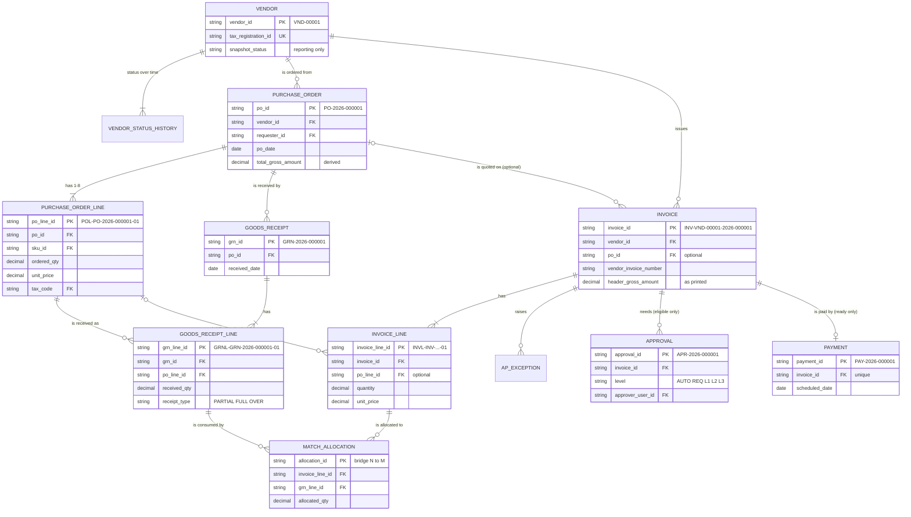
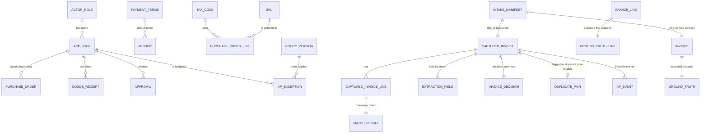
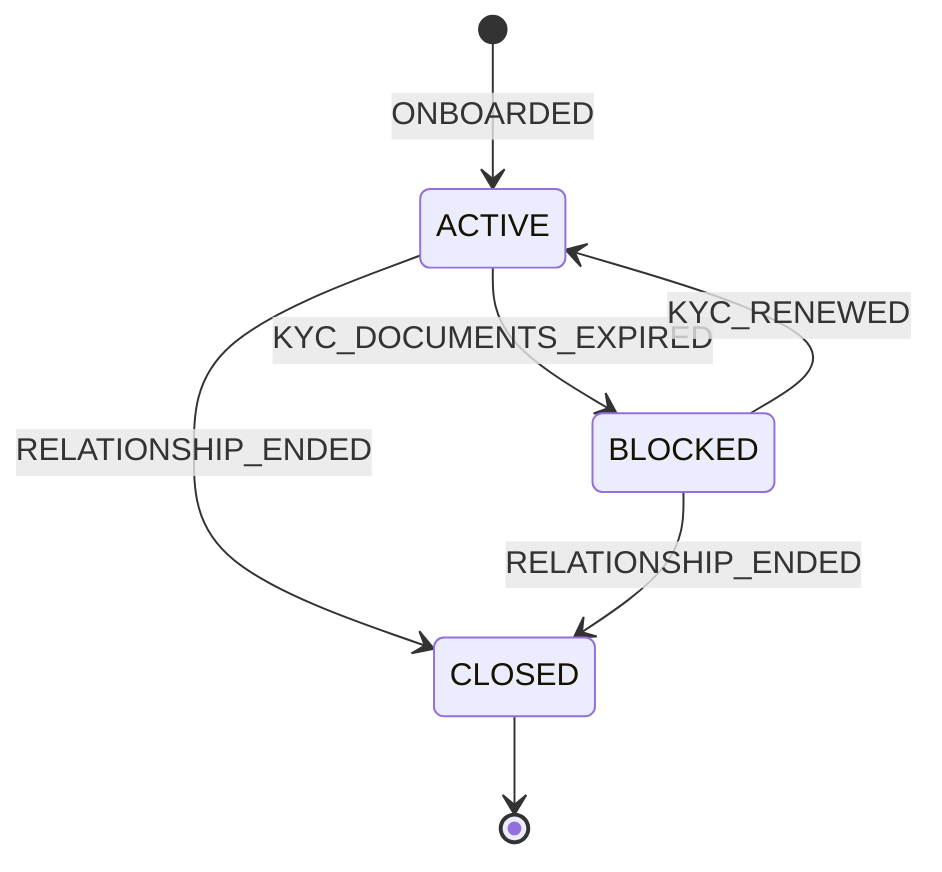
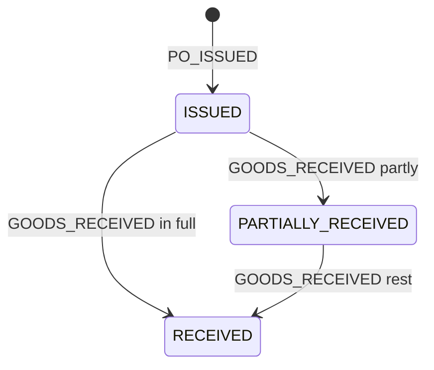
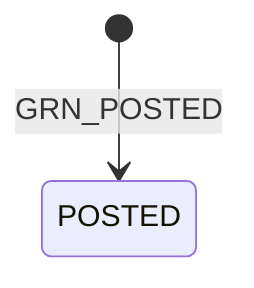
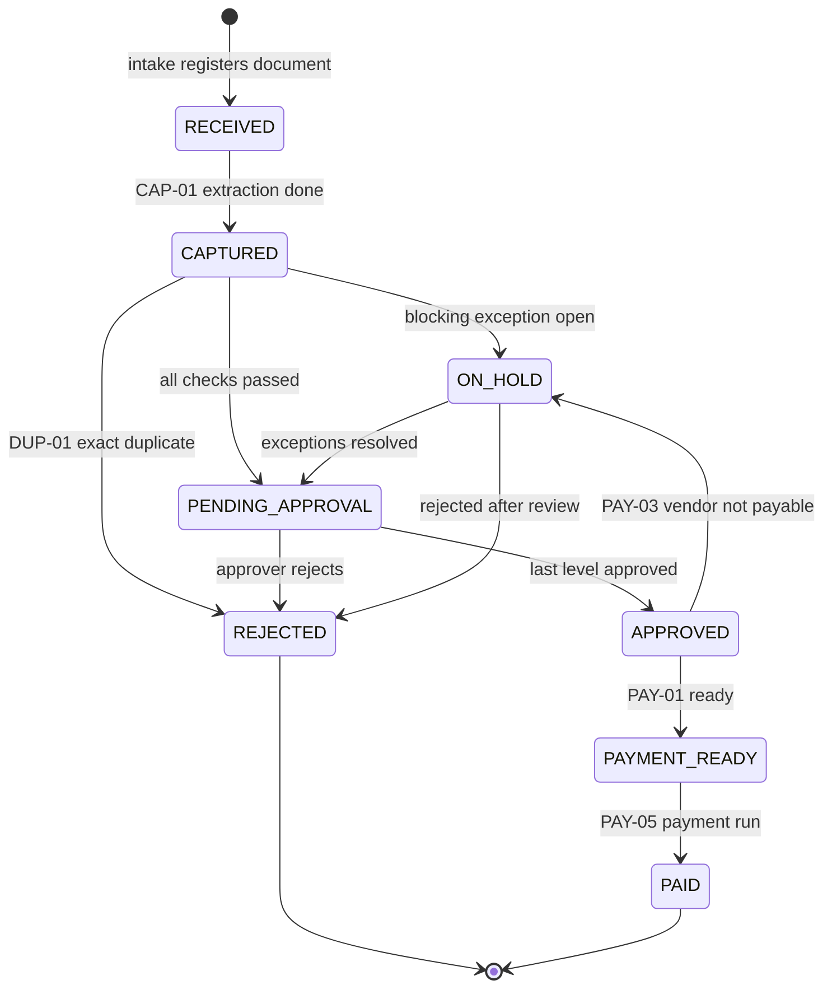
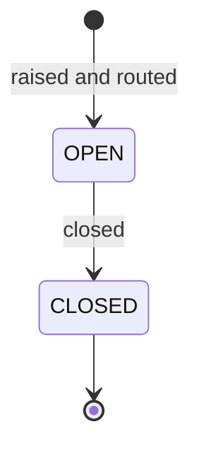
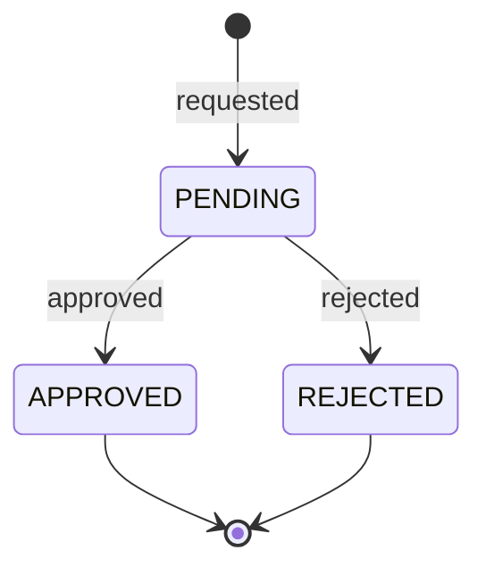
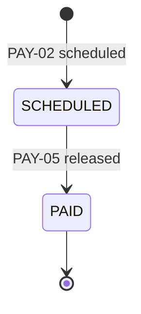

# Schema: entities, keys, cardinality, effective dates and lifecycles

Field-level detail for every table is in [data_dictionary.md](data_dictionary.md). This page covers
how the tables relate. The key list and the state machines below are generated from code
(`invoice_ap/spec`, `invoice_ap/common/lifecycle.py`), so they cannot drift from the implementation.

## 1. Entities and layers

The nine assignment entities are **Vendor, PurchaseOrder, PurchaseOrderLine, GoodsReceipt,
GoodsReceiptLine, Invoice, InvoiceLine, Approval and Payment**. Supporting tables are the reference
data (actor roles, users, payment terms, tax codes, SKUs), the vendor status history, the event
logs, the intake manifest, the engine's capture, match, exception and decision tables, the
`match_allocation` bridge, and the ground truth.

The Invoice entity has two physical representations, linked 1:1 through `doc_id`:

- `source/invoice` (+ `invoice_line`): the invoice as the vendor issued it, which is what the
  document prints. It is evaluation-only and serves as the extraction ground truth. Its
  `invoice_id` uses the true vendor: `INV-<vendor_id>-2026-<intake_seq>`.
- `processed/captured_invoice` (+ `captured_invoice_line`): the invoice as the AP system captured it.
  Approvals, payments, exceptions and events reference this record, because the engine never sees
  the source layer. The engine assigns its `invoice_id` itself (rule ID-01), only after resolving
  the vendor from the printed tax registration number (VEN-01). The intake manifest has no
  `invoice_id`, so the vendor is never handed to the engine (ADR-037).

The two `invoice_id`s are equal exactly when the engine resolved the vendor correctly, so their
agreement is a measured outcome, not an input. The `doc_id` link is a logical 1:1 relationship
validated by the evaluation. It is not declared as a foreign key, because engine-written tables
may not point into evaluation-only layers (enforced by `tests/test_spec.py`).

## 2. Logical ERD: core entities

## 3. Supporting tables

`erp_event` (PO and GRN lifecycle) and `ap_event` (invoice, exception, approval and payment
lifecycle) reference their entity through `(entity_type, entity_id)`.

## 4. Primary keys, unique keys and foreign keys

<!-- BEGIN GENERATED: keys (python -m invoice_ap docs) -->
| Table | Layer | Primary key | Other unique keys | Foreign keys (column -> target) |
|---|---|---|---|---|
| `actor_role` | master | `role_code` | - | - |
| `app_user` | master | `user_id` | `display_name`, `email` | `role_code` -> `actor_role.role_code` |
| `payment_terms` | master | `terms_code` | - | - |
| `tax_code` | master | `tax_code` | - | - |
| `sku` | master | `sku_id` | `description` | `default_tax_code` -> `tax_code.tax_code` |
| `vendor` | master | `vendor_id` | `vendor_name`, `tax_registration_id`, `remit_email` | `payment_terms_code` -> `payment_terms.terms_code` `created_by` -> `app_user.user_id` |
| `vendor_status_history` | master | `vsh_id` | `(vendor_id, seq)` | `vendor_id` -> `vendor.vendor_id` `actor_id` -> `app_user.user_id` |
| `purchase_order` | master | `po_id` | - | `vendor_id` -> `vendor.vendor_id` `requester_id` -> `app_user.user_id` `payment_terms_code` -> `payment_terms.terms_code` |
| `purchase_order_line` | master | `po_line_id` | `(po_id, line_number)` | `po_id` -> `purchase_order.po_id` `sku_id` -> `sku.sku_id` `tax_code` -> `tax_code.tax_code` |
| `goods_receipt` | master | `grn_id` | - | `po_id` -> `purchase_order.po_id` `vendor_id` -> `vendor.vendor_id` `received_by` -> `app_user.user_id` |
| `goods_receipt_line` | master | `grn_line_id` | `(grn_id, line_number)`, `(grn_id, po_line_id)` | `grn_id` -> `goods_receipt.grn_id` `po_line_id` -> `purchase_order_line.po_line_id` |
| `erp_event` | master | `event_id` | `(entity_type, entity_id, seq)` | `actor_id` -> `app_user.user_id` |
| `intake_manifest` | inbox | `doc_id` | `intake_seq`, `file_path` | `sender_vendor_id` -> `vendor.vendor_id` (optional) |
| `invoice` | source | `invoice_id` | `doc_id` | `doc_id` -> `intake_manifest.doc_id` `vendor_id` -> `vendor.vendor_id` `po_id` -> `purchase_order.po_id` (optional) `attention_user_id` -> `app_user.user_id` (optional) |
| `invoice_line` | source | `invoice_line_id` | `(invoice_id, line_number)` | `invoice_id` -> `invoice.invoice_id` `po_line_id` -> `purchase_order_line.po_line_id` (optional) `sku_id` -> `sku.sku_id` (optional) `tax_code` -> `tax_code.tax_code` |
| `ground_truth` | ground_truth | `invoice_id` | `doc_id` | `invoice_id` -> `invoice.invoice_id` `doc_id` -> `intake_manifest.doc_id` `expected_duplicate_of` -> `invoice.invoice_id` (optional) |
| `ground_truth_line` | ground_truth | `invoice_line_id` | - | `invoice_line_id` -> `invoice_line.invoice_line_id` `invoice_id` -> `invoice.invoice_id` |
| `captured_invoice` | processed | `invoice_id` | `doc_id` | `doc_id` -> `intake_manifest.doc_id` `vendor_id` -> `vendor.vendor_id` (optional) `po_id` -> `purchase_order.po_id` (optional) `attention_user_id` -> `app_user.user_id` (optional) |
| `captured_invoice_line` | processed | `invoice_line_id` | `(invoice_id, line_number)` | `invoice_id` -> `captured_invoice.invoice_id` `po_line_id` -> `purchase_order_line.po_line_id` (optional) `sku_id` -> `sku.sku_id` (optional) `tax_code` -> `tax_code.tax_code` |
| `extraction_field` | processed | `extraction_field_id` | `(doc_id, invoice_line_id, field_name)` | `doc_id` -> `intake_manifest.doc_id` `invoice_id` -> `captured_invoice.invoice_id` `invoice_line_id` -> `captured_invoice_line.invoice_line_id` (optional) |
| `invoice_decision` | processed | `invoice_id` | - | `invoice_id` -> `captured_invoice.invoice_id` `duplicate_of_invoice_id` -> `captured_invoice.invoice_id` (optional) `payment_id` -> `payment.payment_id` (optional) `policy_version` -> `policy_version.policy_version` |
| `match_result` | processed | `invoice_line_id` | - | `invoice_line_id` -> `captured_invoice_line.invoice_line_id` `invoice_id` -> `captured_invoice.invoice_id` `po_line_id` -> `purchase_order_line.po_line_id` (optional) `po_tax_code` -> `tax_code.tax_code` (optional) |
| `match_allocation` | processed | `allocation_id` | `(invoice_line_id, grn_line_id)` | `invoice_line_id` -> `captured_invoice_line.invoice_line_id` `grn_line_id` -> `goods_receipt_line.grn_line_id` |
| `duplicate_pair` | processed | `duplicate_pair_id` | `invoice_id` | `invoice_id` -> `captured_invoice.invoice_id` `original_invoice_id` -> `captured_invoice.invoice_id` |
| `ap_exception` | processed | `exception_id` | - | `invoice_id` -> `captured_invoice.invoice_id` `invoice_line_id` -> `captured_invoice_line.invoice_line_id` (optional) `policy_version` -> `policy_version.policy_version` `related_invoice_id` -> `captured_invoice.invoice_id` (optional) `assigned_user_id` -> `app_user.user_id` |
| `approval` | processed | `approval_id` | `(invoice_id, level)`, `(invoice_id, sequence)` | `invoice_id` -> `captured_invoice.invoice_id` `approver_user_id` -> `app_user.user_id` `policy_version` -> `policy_version.policy_version` |
| `payment` | processed | `payment_id` | `invoice_id` | `invoice_id` -> `captured_invoice.invoice_id` `vendor_id` -> `vendor.vendor_id` `policy_version` -> `policy_version.policy_version` |
| `ap_event` | processed | `event_id` | `(entity_type, entity_id, seq)` | `invoice_id` -> `captured_invoice.invoice_id` `actor_id` -> `app_user.user_id` `policy_version` -> `policy_version.policy_version` |
| `policy_version` | processed | `policy_version` | - | - |

29 tables, 69 foreign keys. Polymorphic event references (`erp_event.entity_id`, `ap_event.entity_id`) are validated against the table named by `entity_type` instead of a declared FK.
<!-- END GENERATED: keys -->

## 5. Cardinality

| # | Parent | Child | Cardinality | Optionality | Implemented by |
|---|---|---|---|---|---|
| C1 | vendor | vendor_status_history | 1:N (1..n) | every vendor has an ONBOARDED row | `vendor_status_history.vendor_id` |
| C2 | vendor | purchase_order | 1:N (0..n) | SERVICES vendors have no POs | `purchase_order.vendor_id` |
| C3 | purchase_order | purchase_order_line | 1:N (1..8) | mandatory | `purchase_order_line.po_id` |
| C4 | purchase_order | goods_receipt | 1:N (0..3) | 0 for open and missing-receipt POs | `goods_receipt.po_id` |
| C5 | goods_receipt | goods_receipt_line | 1:N (1..n) | mandatory | `goods_receipt_line.grn_id` |
| C6 | purchase_order_line | goods_receipt_line | 1:N (0..n) | split deliveries give n > 1 | `goods_receipt_line.po_line_id` |
| C7 | vendor | invoice | 1:N (0..n) | - | `invoice.vendor_id` |
| C8 | purchase_order | invoice | 0..1 : N | optional: non-PO invoices have none | `invoice.po_id` (nullable) |
| C9 | invoice | invoice_line | 1:N (1..n) | mandatory | `invoice_line.invoice_id` |
| C10 | purchase_order_line | invoice_line | 0..1 : N | optional: service lines have none | `invoice_line.po_line_id` (nullable) |
| C11 | invoice_line | goods_receipt_line | **N:M** | either side may have no allocation | bridge `match_allocation` |
| C12 | invoice | approval | 1:N (0..4) | only eligible invoices get approvals | `approval.invoice_id` |
| C13 | invoice | payment | 1:0..1 | only payment-ready invoices | `payment.invoice_id` (unique) |
| C14 | invoice | ap_exception | 1:N (0..n) | - | `ap_exception.invoice_id` |
| C15 | invoice (duplicate) | invoice (original) | N:1 | only detected duplicates | `duplicate_pair` |
| C16 | intake_manifest | invoice / captured_invoice | 1:1 | mandatory | `doc_id` (unique) |
| C17 | invoice | captured_invoice | 1:1 | logical link, not a declared FK | shared `doc_id`; equal `invoice_id` is a measured VEN-01 outcome |
| C18 | invoice / invoice_line | ground_truth / ground_truth_line | 1:1 | mandatory | `invoice_id`, `invoice_line_id` |
| C19 | captured_invoice_line | match_result | 1:1 | non-PO lines get NOT_APPLICABLE | `match_result.invoice_line_id` |
| C20 | actor_role | app_user | 1:N | every role has at least one user | `app_user.role_code` |
| C21 | app_user | purchase_order, goods_receipt, approval, ap_exception, events | 1:N | role-restricted | the various `*_id` columns |
| C22 | payment_terms, tax_code, sku | vendor, PO lines, invoice lines | 1:N | - | reference FKs |
| C23 | every stateful entity | its events | 1:N (1..n) | creation event mandatory | `vendor_status_history`, `erp_event`, `ap_event` |

The many-to-many relationship C11 is generated in both directions:
- archetype A21 (`C-CONSOLIDATED`, 45 POs at full scale): one invoice line consumes two receipt
  lines;
- archetype A12 (`C-PARTIAL-BILLING`, 10 POs, 20 invoices): one receipt line is consumed by two
  invoice lines, because the vendor bills one delivery in parts.

The bridge allocates billed quantity to received quantity in FIFO order of posting.

## 6. Optional relationships and conditional fields

- `invoice.po_id` and `invoice_line.po_line_id` / `sku_id` are empty for non-PO (services) invoices,
  which carry `attention_user_id` (the requester who approves them) instead.
- `captured_invoice.vendor_id` / `po_id` and `captured_invoice_line.po_line_id` are empty when the
  engine cannot resolve the printed reference (VEN-01, PO-01, PO-03 then raise an exception).
- `ap_exception.invoice_line_id` is empty for header-level exceptions; `related_invoice_id` is set
  only for duplicates.
- `approval` rows exist only for eligible invoices and `payment` rows only for payment-ready ones
  (assignment: "create approval/payment records only for eligible invoices").
- `app_user.cost_center` is set for requesters and L1 approvers; `approval_level` only for approvers.
- `approval.decided_at` and `payment.paid_at` are empty while PENDING / SCHEDULED at the as-of date.

## 7. Effective dates

| What | Effective-date rule |
|---|---|
| Vendor active window | Starts at `onboarded_date` (the ONBOARDED status row). Status on date *d* = `to_status` of the last `vendor_status_history` row with `effective_date <= d`. A BLOCKED window runs until the next ACTIVE row; CLOSED is terminal. VEN-02/03 use the **invoice date**; PAY-03 uses the **payment-ready date**. |
| Tax-code validity | `tax_code.valid_from` / `valid_to`. TAX-01 checks the code on the invoice date; PO lines use codes valid on `po_date`. `GST12` is a retired code (valid to 2025-09-21) that exists only to exercise the validity rule. |
| Policy version | `[policy] version = 1.0.0`, `effective_from = 2026-01-01`. Every decision, exception, approval, payment and event stores `policy_version`; `policy_version.sha256` pins the exact file. |
| Payment terms | Copied onto the PO at issue (snapshot), so a later change to the vendor's default would not alter open POs. Due date = invoice date + term days. |
| PO validity | Not modelled: POs do not expire. `promised_delivery_date` is informational and drives the generated receipt dates. |
| Users | `app_user.active_from`; every user is active for the whole of 2026. |
| As-of date | `policy.as_of_date = 2026-10-22`, a fixed past date. Every `*_as_of` and `snapshot_*` value is evaluated then, and no completed event lies after it. The master `snapshot_*` columns are reporting only and never an engine input (ADR-038). |

## 8. Lifecycle state machines

Every state change is an append-only event (`vendor_status_history`, `erp_event`, `ap_event`)
carrying from-status, to-status, timestamp, actor role and id, and a reason or rule id. History is
never overwritten. An entity's current status (`snapshot_status` in master, `*_as_of` in processed) must
equal the `to_status` of its last event, and the validation suite checks every recorded
sequence against these machines.

<!-- BEGIN GENERATED: state-machines (python -m invoice_ap docs) -->
#### VENDOR

| From | To | Label | Trigger | Produced by the simulation |
|---|---|---|---|---|
| (create) | ACTIVE | ONBOARDED | system administrator onboards the vendor; effective = onboarded_date | yes |
| ACTIVE | BLOCKED | KYC_DOCUMENTS_EXPIRED | system administrator blocks the vendor | yes |
| BLOCKED | ACTIVE | KYC_RENEWED | system administrator reinstates the vendor | yes |
| ACTIVE | CLOSED | RELATIONSHIP_ENDED | system administrator closes the vendor | yes |
| BLOCKED | CLOSED | RELATIONSHIP_ENDED | system administrator closes a blocked vendor | yes |

#### PURCHASE_ORDER

| From | To | Label | Trigger | Produced by the simulation |
|---|---|---|---|---|
| (create) | ISSUED | PO_ISSUED | business requester raises and issues the PO | yes |
| ISSUED | PARTIALLY_RECEIVED | GOODS_RECEIVED partly | a GRN leaves some ordered quantity open | yes |
| ISSUED | RECEIVED | GOODS_RECEIVED in full | a GRN receives every line in full or over | yes |
| PARTIALLY_RECEIVED | RECEIVED | GOODS_RECEIVED rest | a later GRN receives the remaining quantity | yes |

#### GOODS_RECEIPT

| From | To | Label | Trigger | Produced by the simulation |
|---|---|---|---|---|
| (create) | POSTED | GRN_POSTED | the business requester who confirmed the receipt posts the GRN | yes |

#### INVOICE

| From | To | Label | Trigger | Produced by the simulation |
|---|---|---|---|---|
| (create) | RECEIVED | intake registers document | intake registers the document (SYSTEM) | yes |
| RECEIVED | CAPTURED | CAP-01 extraction done | extraction finished and ID-01 assigned the invoice ID (SYSTEM) | yes |
| CAPTURED | ON_HOLD | blocking exception open | at least one blocking exception is open (SYSTEM) | yes |
| CAPTURED | REJECTED | DUP-01 exact duplicate | exact resubmission of an earlier invoice (SYSTEM) | yes |
| CAPTURED | PENDING_APPROVAL | all checks passed | APR-01 approval chain requested (SYSTEM) | yes |
| PENDING_APPROVAL | APPROVED | last level approved | the last required approval level approved | yes |
| PENDING_APPROVAL | REJECTED | approver rejects | an approver rejects the invoice | no (no policy rule triggers it) |
| APPROVED | PAYMENT_READY | PAY-01 ready | readiness satisfied and payment scheduled (SYSTEM) | yes |
| APPROVED | ON_HOLD | PAY-03 vendor not payable | vendor not payable on the ready date (SYSTEM) | yes |
| ON_HOLD | PENDING_APPROVAL | exceptions resolved | owners resolve every blocking exception | no (no policy rule triggers it) |
| ON_HOLD | REJECTED | rejected after review | rejected after the owner's review | no (no policy rule triggers it) |
| PAYMENT_READY | PAID | PAY-05 payment run | payment run releases the payment (SYSTEM) | yes |

#### EXCEPTION

| From | To | Label | Trigger | Produced by the simulation |
|---|---|---|---|---|
| (create) | OPEN | raised and routed | RTE-01 routes it to a role and queue (SYSTEM) | yes |
| OPEN | CLOSED | closed | auto-closed when the invoice is REJECTED, or resolved by its owner | yes |

#### APPROVAL

| From | To | Label | Trigger | Produced by the simulation |
|---|---|---|---|---|
| (create) | PENDING | requested | requested in sequence (SYSTEM) | yes |
| PENDING | APPROVED | approved | approver decides after the level's turnaround (APR-SIM-01); AUTO at once | yes |
| PENDING | REJECTED | rejected | approver rejects | no (no policy rule triggers it) |

#### PAYMENT

| From | To | Label | Trigger | Produced by the simulation |
|---|---|---|---|---|
| (create) | SCHEDULED | PAY-02 scheduled | payment created and scheduled (PAY-01, PAY-02; SYSTEM) | yes |
| SCHEDULED | PAID | PAY-05 released | payment run on a scheduled date on or before the as-of date (SYSTEM) | yes |
<!-- END GENERATED: state-machines -->

## 9. Join validation

The validation suite checks every declared FK above. It also checks these semantic joins:
- the vendor code embedded in each `invoice_id` equals `invoice.vendor_id`, and for captured
  invoices equals `captured_invoice.vendor_id`, or `VND-00000` when it is unresolved;
- each line's parent ID embedded in `po_line_id`, `grn_line_id` and `invoice_line_id` equals its FK;
- `goods_receipt.vendor_id` equals the PO's vendor;
- each GRN line's PO line belongs to the GRN's PO;
- each invoice line's PO line belongs to the invoice's PO;
- each allocation's GRN line and invoice line share a PO line;
- the 1:1 identity links of C16 to C19;
- polymorphic event references.

Deliberately labelled defects are reported separately from violations, for example an invoice that
quotes another vendor's PO (`VENDOR_PO_MISMATCH`). All declared FKs stay valid in generated data.
